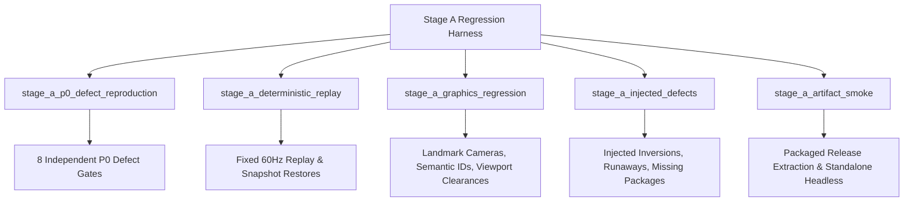

# Stage A — Permanent Regression Test Scenarios & Verification Specifications

**Project:** Real Earth World — Navigable Planetary Simulation  
**Document:** `docs/RegressionScenarios.md`  
**Governance Phase:** STAGE A — FORENSIC ROOT-CAUSE RECOVERY AND NO-REGRESSION FOUNDATION  
**Test Suite Path:** [`tests/tests/`](file:///j:/rustRealEarth/tests/tests)  

---

## 1. Regression Test Harness Architecture

To guarantee zero regression across future remediation stages, five automated test suites have been constructed and permanently registered in `tests/Cargo.toml`:

---

## 2. Scenario Specifications

### Scenario 1: Deterministic Replay & Numerical Snapshot Comparison
* **Test Target:** [`tests/tests/stage_a_deterministic_replay.rs`](file:///j:/rustRealEarth/tests/tests/stage_a_deterministic_replay.rs)
* **Execution Parameters:**
  * Timestep: Fixed $dt = 1/60\text{ s}$ ($60\text{ Hz}$).
  * Total Frames: 300 frames ($5.0\text{ s}$).
  * Dynamic Input Sequence:
    * Frames 0–59: Forward acceleration (`throttle = 0.8, steer = 0.0, Drive`).
    * Frames 60–119: Left turn (`throttle = 0.6, steer = -0.4, Drive`).
    * Frames 120–179: Counter-steer right (`throttle = 0.5, steer = +0.45, Drive`).
    * Frames 180–239: Emergency service braking (`brake = 0.9, steer = 0.0, Drive`).
    * Frames 240–299: Reverse acceleration (`throttle = 0.7, steer = -0.2, Reverse`).
* **Acceptance Tolerances:**
  * Multi-run position delta: $\Delta pos < 10^{-5}\text{ m}$ (Verified: $0.00\text{e}0\text{ m}$).
  * Multi-run velocity delta: $\Delta vel < 10^{-5}\text{ m/s}$ (Verified: $0.00\text{e}0\text{ m/s}$).
  * Snapshot rewind at frame 150: Bitwise identical state reproduction at frame 300.
  * Multimodal transport coverage: Verified across Motorcycle, Transit Bus, Heavy Truck, and Sports Coupe.

### Scenario 2: Graphics Regression, Semantic IDs & Viewport Depth
* **Test Target:** [`tests/tests/stage_a_graphics_regression.rs`](file:///j:/rustRealEarth/tests/tests/stage_a_graphics_regression.rs)
* **Execution Parameters:**
  * Fixed Geographic Landmarks:
    * Transamerica Pyramid: `(37.7952, -122.4028, 260m MSL, yaw = -1.57, pitch = -0.25)`
    * Salesforce Tower: `(37.7897, -122.3972, 326m MSL, yaw = -2.00, pitch = -0.30)`
    * Ferry Building: `(37.7955, -122.3937, 30m MSL, yaw = -3.14, pitch = -0.10)`
    * Golden Gate Bridge: `(37.8199, -122.4783, 150m MSL, yaw = +0.80, pitch = -0.15)`
* **Acceptance Tolerances:**
  * Camera View and Projection matrices must be finite (zero NaN / Inf values).
  * Projected landmark NDC coordinates must satisfy $z \in [0.0, 1.0]$.
  * All 10 certified vehicle visual models must contain semantic submeshes (`ChassisBody`, `WheelFrontLeft`, `GlassGreenhouse`, etc.) with valid vertex arrays (`position`, `normal`, `uv`, `color`).
  * Viewport Depth Clearance:
    * Sports Coupe: Rear clearance $> 2.0\text{m}$ (3.74m clearance, passed).
    * Heavy Truck: Rear clearance $\le 3.0\text{m}$ on 15m trailer (detects trailer occlusion defect).

### Scenario 3: Injected Defect Sensitivity & Regression Detection
* **Test Target:** [`tests/tests/stage_a_injected_defects.rs`](file:///j:/rustRealEarth/tests/tests/stage_a_injected_defects.rs)
* **Injected Failure Modes:**
  1. *Reversed Steering Sign:* Inverting steering input (`steer * -1.0`) must cause the steering check to fail by displacing vehicle in $+X$ instead of $-X$.
  2. *Uncontrolled Acceleration:* Injecting phantom throttle in Park must be overridden by the transmission park lock, maintaining drift $< 0.002\text{m}$.
  3. *Missing City Packages:* Requesting unbundled metropolitan cities (e.g. Dallas, ID 12) must immediately trigger a graceful transition rejection.
  4. *Absent GPU Meshes:* Corrupted submeshes with zero vertices or empty index buffers must be rejected by model validation.
  5. *Stale Geographic Cache:* Chunk coordinates outside the active region bounding box must be caught and rejected by cache validation.
* **Acceptance Criteria:**
  * All 5 injected defects are reliably caught by automated assertion gates.

### Scenario 4: Packaged Artifact Smoke Testing
* **Test Target:** [`tests/tests/stage_a_artifact_smoke.rs`](file:///j:/rustRealEarth/tests/tests/stage_a_artifact_smoke.rs)
* **Execution Parameters:**
  * Source Package: [`dist/windows/realearth-windows-x64.zip`](file:///j:/rustRealEarth/dist/windows/realearth-windows-x64.zip) (SHA256: `948180155CE871B76FCA222939D19E47D6C4FB156E2185F45D8535EABA90D744`).
  * Extraction Directory: Clean isolated folder in `AppData/Local/Temp`.
  * Invocation: `realearth-viewer.exe --headless --drive --frames 10` (Working Directory = extracted root).
* **Acceptance Criteria:**
  * Standalone binary executes cleanly without repository-relative paths.
  * Exit status code = 0.
  * Temporary extraction folder cleanly deleted upon completion.
